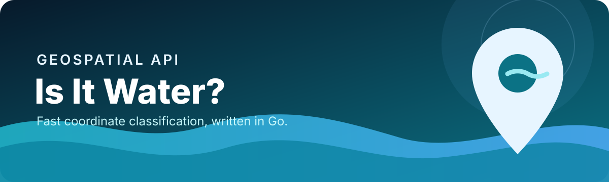

<div align="center">
  

  # Is It Water? — Go

  **A fast, local water-body lookup API powered by NASA ASTER tiles.**

  [](https://github.com/auroravicks/is-it-water-go/actions/workflows/ci.yml)
  [](https://go.dev/)
  [](#api)

  [Quick start](#quick-start) · [API](#api) · [How it works](#how-it-works) · [Python version](https://github.com/auroravicks/is-on-water)
</div>

---

Give the service a latitude and longitude and it returns whether that point is on
water, plus the ASTER feature classification (`OCEAN`, `RIVER`, `LAKE`, `LAND`,
or `UNKNOWN`). Lookups happen locally against 1° × 1° dataset tiles—no external
geocoding service is called.

## Highlights

- Local, deterministic coordinate lookups
- Simple HTTP/JSON interface built with Gin
- Tile-level reads from NASA ASTER Water Body Dataset archives
- Ocean, river, lake, and land classifications
- A compact Go implementation for low-overhead deployments

## Quick start

### Requirements

- Go 1.24 or newer
- ASTWBD tile archives from [`is-on-water-dataset`](https://github.com/auroravicks/is-on-water-dataset)
- About 2 GB of disk space for the complete global tile set

```bash
git clone https://github.com/auroravicks/is-it-water-go.git
cd is-it-water-go
go mod download
git clone https://github.com/auroravicks/is-on-water-dataset.git ../is-on-water-dataset
DATASET_PATH=../is-on-water-dataset/dataset go run .
```

The API listens on `http://127.0.0.1:8000`.

On Windows PowerShell, set `DATASET_PATH` before starting the server:

```powershell
$env:DATASET_PATH = "..\is-on-water-dataset\dataset"
go run .
```

```bash
curl http://127.0.0.1:8000/is-it-water/45.295504/12.61337
```

## API

### `GET /is-it-water/:lat/:lon`

| Parameter | Type | Range | Description |
| --- | --- | --- | --- |
| `lat` | number | -90 to 90 | Latitude in decimal degrees |
| `lon` | number | -180 to 180 | Longitude in decimal degrees |

Example response:

```json
{
  "isWater": true,
  "feature": "OCEAN",
  "lat": 45.295504,
  "lon": 12.61337,
  "reqMs": 12
}
```

`UNKNOWN` means a matching tile or readable feature value was unavailable. It
should not be treated as a positive water classification.

## How it works

```text
latitude + longitude
        │
        ▼
derive the 1° ASTER tile ID
        │
        ▼
open the matching ZIP and GeoTIFF
        │
        ▼
translate the coordinate to a pixel
        │
        ▼
map the pixel value to a feature label
```

The service expects filenames such as `ASTWBDV001_N45E012.zip`. Each archive
contains a corresponding `*_att.tif` classification raster.

## Project layout

```text
.
├── dataset/       # ASTWBD tile archives
├── utils/         # Tile naming and TIFF field helpers
├── water/         # Water classification logic
├── main.go        # Gin API server
└── water_test.go  # API integration checks
```

## Development

```bash
gofmt -w .
go vet ./...
go build ./...
```

The integration test expects the API to be running in another terminal:

```bash
go run .
# another terminal
go test ./...
```

See [CONTRIBUTING.md](CONTRIBUTING.md) for contribution guidance.

## Data source

This project uses NASA's ASTER Water Body Dataset (ASTWBD), a global water mask
with approximately 30 m resolution at the equator. Dataset installation,
checksums, attribution, and citation guidance live in
[`auroravicks/is-on-water-dataset`](https://github.com/auroravicks/is-on-water-dataset).

## Acknowledgements

This Go implementation is based on the concept and dataset approach established
by Nicius Balbona's original
[`NiciusB/is-on-water`](https://github.com/NiciusB/is-on-water) project. Credit
for the original Is On Water project and API concept belongs to its author and
contributors. This port is independently maintained and is not an official
upstream release.

## Related project

Prefer Python and FastAPI? See [auroravicks/is-on-water](https://github.com/auroravicks/is-on-water).
